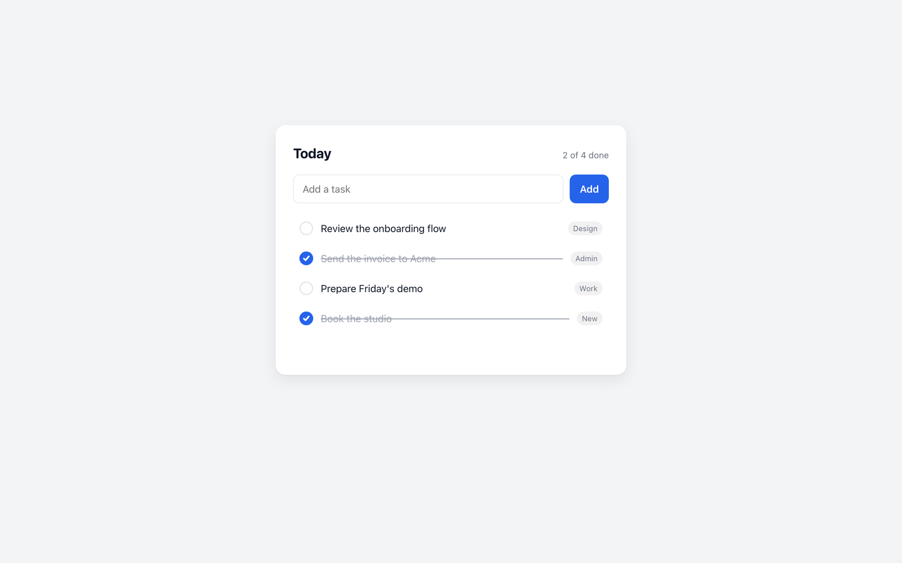

# ui-clips

<a href="docs/media/todo-add.mp4"></a>

*A clip the plugin made of [its own demo page](examples/todo-demo): [watch the MP4](docs/media/todo-add.mp4).*

Short, silent, retina-sharp clips and stills of any web UI, recorded from a scenario written in plain words.
When the design changes, one command re-records every clip.

## Install

```bash
claude plugin marketplace add banuakman/ui-clips
claude plugin install ui-clips@ui-clips
```

From a local checkout instead: `claude --plugin-dir /path/to/ui-clips`.

## Three skills

| Skill | Start with |
|---|---|
| `/ui-clips:new-clip-project` | "Make a clip project for https://…" (one round of questions: page layout, output sizes, outputs, auto-zoom, theme, cursor; then `doctor`) |
| `/ui-clips:author-clip` | "The Today list → type a task → Add → the row slides in → tick it → hold." (rehearsed and framed before anything is recorded) |
| `/ui-clips:record-clips` | "Record todo-add" or "re-record what changed" (verified against the quality bar, with a contact sheet) |

## Requirements

Node 20+, ffmpeg and ffprobe on PATH (`brew install ffmpeg` on macOS), and Playwright's Chromium (downloaded on first use). A WebP encoder is optional. `ui-clips doctor` checks Node, ffmpeg with libx264 and libvpx, ffprobe, the WebP encoder, Chromium, that the target URL answers, and whether a password gate opens; it prints the install command for anything missing.

## Docs

- [docs/designers.md](docs/designers.md): making clips without writing code, with the demo as the worked example
- [docs/developers.md](docs/developers.md): the project contract, helper API, capture and export, the CLI, working rules
- [docs/spec.md](docs/spec.md): the specification, the single source of truth
- [CHANGELOG.md](CHANGELOG.md), [CONTRIBUTING.md](CONTRIBUTING.md)

## License

Apache License 2.0; see [LICENSE](LICENSE) and [NOTICE](NOTICE).
